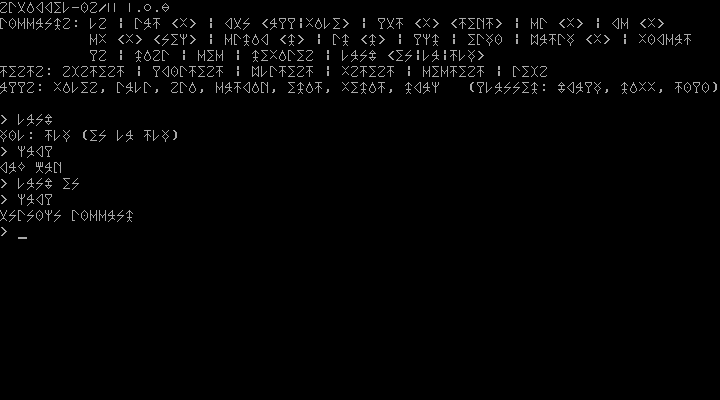

# Squirrel-OS/2

> **Joke branch: `klingon-font`.** An alien world where the PC never had
> ASCII. The kernel writes real pIqaD glyphs over the VGA font's letters
> and digits and boots in Klingon (`lang tlh`), so the whole system reads
> in Klingon script. Not for merging into `main`; see
> [Klingon font](#klingon-font-joke-branch) below. The matching firmware
> joke is SquirrelBIOS's `klingon-font` branch.
>
> 

An original operating-system effort in the spirit of OS/2 Warp.

**Naming note:** The repository is named Squirrel-OS/2 and the project keeps that name.  
Early releases (through 1.0.0) are a usable minimal system.  
Version 2.0.0 is the first release intended to claim Warp-like character  
(preemptive scheduling, windowing, object desktop).  
Version 3.0.0 is the 64-bit evolution aimed at competing with contemporary  
desktop operating systems.  
Do not describe pre-2.0 builds as OS/2.

All material under this tree is project-native.  
Third-party and contemporary sources remain outside this directory.

## Layout

```
squirrel-os2/
├── README.md
├── ROADMAP.md              ← goals, principles, milestones from 0.9.2
├── TODO.md                 ← PR-sized tasks and acceptance checks
├── documentation/          ← ongoing project documentation
│   ├── architecture/
│   ├── kernel/
│   ├── guides/
│   └── releases/
├── kernel/                 ← original kernel code
├── squirrelbios/           ← own firmware tree (also on GitHub)
├── firmware/               ← stub pointer to squirrelbios/
└── docs/                   (legacy pointer; prefer documentation/)
```

## Documentation

See `documentation/README.md` for the living documentation set.

- Forward plan: [ROADMAP.md](ROADMAP.md)
- Task list: [TODO.md](TODO.md)
- Milestone history and the 2.0 / 3.0 vision: `documentation/plannedmilestones.md`

## Current release

**1.0.0** — the usable minimal system: file system, browser, `edit`, `vedit`, `draw`, `calc`, `sci`, `matrix`.  
Build and run with `tools/build.sh` and `tools/run.sh` (`documentation/guides/getting-started.md`).  
Notes: `documentation/releases/1.0.0.md` (patches: `1.0.1.md`, `1.0.2.md`, `1.0.3.md`, `1.0.4.md`, `1.0.5.md`, `1.0.6.md`, `1.0.7.md`, `1.0.8.md`, `1.0.9.md`, `1.0.10.md`, `1.0.11.md`, `1.0.12.md`; 1.1: `1.1.0.md`, `1.1.1.md`; 1.2: `1.2.0.md`). Limits: `documentation/specifications.md`. What to do next: [TODO.md](TODO.md).

## Klingon font (joke branch)

- `tools/klingon-font.py` holds the glyphs as ASCII art and writes
  `kernel/klingon-font.inc`. They are hand-drawn pIqaD letters and digits,
  traced stroke for stroke from a sixteen-segment pIqaD chart (not copied
  from an existing font), the same ones SquirrelBIOS's `klingon-font`
  branch uses.
- `kernel/klingon.asm` loads them into VGA plane 2 at boot, over letters,
  digits and `'` only; punctuation and box drawing keep the BIOS font.
  Latin letters map to the nearest Klingon letter (`d`→`D`, `k`/`c`→`q`,
  `x`→`Q`, `f`→`v`, `z`→`S`), so English text shows in pIqaD too.
- `tools/mkstrings.py` turns `tlh`, `ch`, `gh` and `ng` in the Klingon
  strings into one glyph each (0x80-0x83). Text in `{braces}` (command
  names such as `{echo}`) keeps its Latin letters.
- The whole system speaks Klingon, not just the shell: the banner's command
  list, the loader and file-system messages, and the UI of calc, sci,
  matrix, diff, edit/vedit, draw and the file browser come from
  `localization/*/strings.txt` (`\n` in a value is a newline). Command
  words (`q`, `clear`, `det`, `y/n`) stay as they are. Latin has no
  translations for these yet and falls back to English. The built-in
  `help`, `calc`, `sci`, `matrix` and `diff` files keep their English text.
- The kernel starts in Klingon. Build with `nasm -DDEFAULT_LANG_EN` to start
  in English; `tools/regress.sh` does, so its English checks still apply.
  `lang en` switches at run time (the letters stay alien).

### Refreshing the branch later

As Squirrel-OS/2 grows, rebase the joke onto `main`:

```bash
git fetch origin main
git checkout klingon-font
git rebase origin/main
python3 tools/mkstrings.py      # conflicts in kernel/strings.inc: just regenerate
tools/build.sh && tools/regress.sh
git push --force-with-lease origin klingon-font
```

The joke touches `kernel/klingon.asm`, `kernel/klingon-font.inc`,
`tools/klingon-font.py`, a few lines in `kernel/pm.asm` (font load and
default language), `tools/mkstrings.py` (digraphs, `{}` and `\n`), the
`lang-tlh`, `l10n-calc-tlh` and `l10n-edit-tlh` checks and `nasm -DDEFAULT_LANG_EN` in `tools/regress.sh`, this
README, and the app texts: the keys after the "Klingon branch" comment in
`localization/en` and `localization/tlh`, and the `[lstr+LS_...*4]`,
`lset` and `lcmp` references that replaced the English `db` strings in
the apps, `loader.asm`, `fs.asm`, `shell.asm`, `batch.asm` and
`lang.asm`. On a rebase, a new English app string just shows in English
until it gets a key. New Klingon strings in `localization/tlh/strings.txt`
pick up the digraph glyphs automatically.
